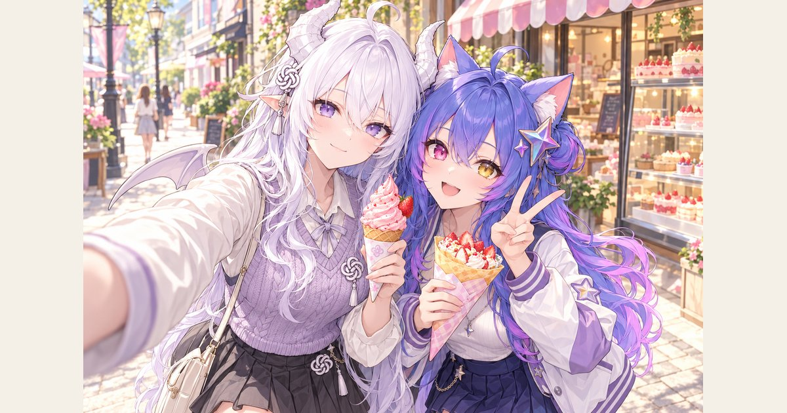

# AI娘图库 · AI Girls Gallery

AI 拟人角色的立绘、换装与故事瞬间。11 位 AI 娘，三个原始素材分类。

**[在线浏览图库](https://sus66618.github.io/ai-girls-gallery/) · [下载全部原图 ZIP](https://github.com/sus66618/ai-girls-gallery/releases/latest/download/ai-girls-all.zip) · [分类下载](https://github.com/sus66618/ai-girls-gallery/releases/latest) · [使用与来源](USAGE.md)**

## 作品分类

| 目录 | 内容 |
| --- | --- |
| [立绘](立绘/) | GPT、Claude、DeepSeek、Gemini、千问 Qwen、Grok、Kimi、MiniMax、智谱 GLM、混元 Hunyuan、豆包 Seed，以及合影 |
| [立绘系列](立绘系列/) | 正装、婚纱、度假、运动、睡衣、冬日、时装秀、Cosplay、科技战士、雨日、泳装、浴衣与童话角色 |
| [插画](插画/) | 场景、故事、CG 与海报 |

原图保留原始目录、文件名和图片格式。网页提供分类与主题筛选、搜索、放大查看、单张原图下载。Releases 提供三个分类 ZIP 和全量 ZIP。`gallery.json` 记录每张图片的路径、尺寸、字节数与 SHA-256，便于核验。

## 创作与署名

- 原始 AI 娘立绘与角色设计来自 Bilibili 创作者 **[ZipZipPipe](https://space.bilibili.com/4168597)**。
- 其他衍生立绘及插画由 **sus66618** 策划整理并使用 GPT 生图工具生成，模型名称按作者提供记为 **Image 2.5**。
- 整理者对其有权许可的新增生成作品开放免费使用、修改、商用和再分发，无强制署名要求。原始第三方作品与标识按各自权利人的许可使用。详见 [USAGE.md](USAGE.md)。

喜欢这些角色，欢迎 Star、分享图库，或者在 Issue 里展示你的二创作品。

## English

An open gallery of AI girls / AI gijinka / AI anthropomorphic characters, featuring 11 personas, character artwork, themed outfits and illustrations.

Browse the **[live gallery](https://sus66618.github.io/ai-girls-gallery/)**, download individual original images, or get complete ZIP collections from **[Releases](https://github.com/sus66618/ai-girls-gallery/releases/latest)**. Original filenames and folder organization are preserved.

Original designs are credited to **ZipZipPipe**. Additional artwork is AI-generated and curated by **sus66618**. See [usage and credits](USAGE.md) for permissions. Website code is MIT-licensed.

## 更新图库

将新图放入三个素材目录，保留有意义的子目录，然后运行 `npm ci` 和 `npm run build`。构建会生成缩略图、静态图库、文件清单和搜索元数据。将生成文件与原图一起提交，GitHub Pages 从 `main` 分支根目录发布。
